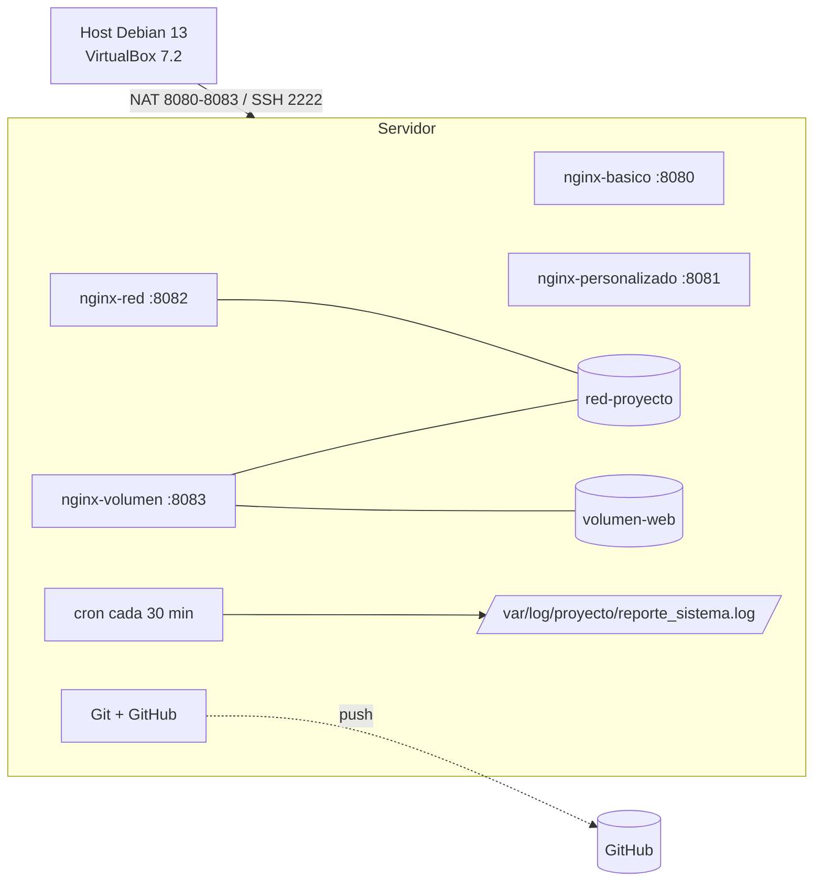

# Análisis del proyecto y plan de trabajo

> **Proyecto Final — Introducción al Software Libre (ISL135)**
> Universidad de El Salvador · Facultad Multidisciplinaria de Occidente
> Ciclo II–2026 · Entrega: **martes 03/11/2026** · Defensas: semanas 13 y 14

---

## 1. Qué pide realmente el proyecto

El objetivo no es solo «instalar Docker»: es **implementar, automatizar, versionar y demostrar un servidor Linux completo**. El enunciado combina cinco áreas que se evalúan juntas:

1. **Administración del sistema:** hostname, usuarios, grupos, sudo, directorios y permisos.
2. **Automatización:** script Bash de monitoreo y tarea cron cada 30 minutos con log.
3. **Control de versiones:** repositorio Git local, repositorio remoto en GitHub, README e historial de los 4 integrantes.
4. **Contenedores:** instalación de Docker, imagen oficial, bind mounts, Dockerfile propio, red personalizada y volumen persistente.
5. **Documentación y defensa:** informe PDF con capturas de cada comando, repositorio completo y presentación de 20 minutos con demostración en vivo.

Las fases 1 a 8 son **acumulativas**: cada una se apoya en la anterior y el orden del PDF es el orden recomendado de ejecución.

---

## 2. Matriz de requisitos → evidencia

| Fase | Lo que pide el PDF | Qué se evalúa realmente | Evidencia que debes capturar |
|---|---|---|---|
| 1.1 | Hostname `servidor-grupoX`; usuarios `adminsys`, `tecnico`, `visitante`; grupos `soporte` y `web`; `adminsys` con sudo; `tecnico` en `soporte`; `visitante` en `web` | Administración de usuarios y grupos | `hostnamectl`; `id` de los tres usuarios; `getent group soporte web sudo` |
| 1.2 | `/proyecto/{datos,web,scripts,capturas}`; `datos` del grupo `soporte`; `web` del grupo `web`; herencia de grupo | Permisos y bit setgid | `ls -ld /proyecto/*`; archivo creado por `tecnico` y por `visitante` mostrando el grupo heredado |
| 2.1 | `reporte_sistema.sh` ejecutable con fecha, hostname, usuarios, disco, RAM y contenedores activos | Bash y comandos de monitoreo | Ejecución manual con la salida completa |
| 2.2 | Cron cada 30 min hacia `/var/log/proyecto/reporte_sistema.log` | Automatización y verificación del log | Archivo de cron; `tail` del log con dos entradas separadas ~30 min |
| 3 | `git init` en `/proyecto`; primer commit; repo `proyecto-linux-grupoX`; README; commits de todos | Git local, remoto y trabajo en equipo | `git log --graph`; `git remote -v`; pantalla del repo en GitHub |
| 4.1 | Instalar Docker, habilitar/iniciar servicio, agregar `adminsys` y `tecnico` al grupo `docker`, verificar | Instalación y configuración | `docker version`; `docker info`; `id adminsys`; `systemctl status docker` |
| 4.2 | Ejecutar `hello-world` y listar contenedores | Descarga de imágenes y ejecución | Salida de `hello-world`; `docker ps -a` |
| 5.1 | `index.html` en `/proyecto/web`; Nginx detached; `8080:80`; montar `/proyecto/web` en `/usr/share/nginx/html` | Contenedor, puerto y bind mount | `docker ps`; `docker port`; `curl -I`; navegador en 8080 |
| 5.2 | Acceder por navegador a `http://localhost:8080`; revisar logs | Verificación funcional | Captura del navegador; `docker logs` sin errores |
| 6.1 | Dockerfile con `nginx:latest`, `COPY web/`, `EXPOSE 80`, `CMD`; imagen `servidor-grupoX` | Construcción de imágenes | Dockerfile; salida de `docker build`; `docker images` |
| 6.2 | Contenedor con la imagen propia en `8081:80`; comparar con Nginx oficial | Imagen inmutable vs bind mount | Navegador en 8081; tabla comparativa; `docker history` |
| 7.1 | Red `red-proyecto`; Nginx conectado; puerto 8082 | Redes Docker | `docker network inspect red-proyecto` mostrando el contenedor |
| 7.2 | Volumen `volumen-web`; Nginx montándolo; puerto 8083 | Persistencia | `docker volume inspect`; archivo dentro del volumen; navegador en 8083 |
| 8.1 | Alpine en `red-proyecto` haciendo ping al Nginx | Diagnóstico de red y DNS interno | Salida de `ping` con 4 paquetes |
| 8.2 | Los 4 servicios activos; cron cada 30 min; contenedores corriendo; Git actualizado | Verificación integral | `docker ps`; matriz de 4 puertos; `tail` del log; `git status` |

---

## 3. Arquitectura propuesta

```
Host Debian 13 (VirtualBox 7.2)
│
│  NAT: 2222→22, 8080→8080, 8081→8081, 8082→8082, 8083→8083
▼
VM Debian 13 «servidor-grupo1» (sin escritorio, administrada por SSH)
│
├── Docker Engine (servicio habilitado)
│   ├── nginx-basico        :8080  → bind mount /proyecto/web (ro)
│   ├── nginx-personalizado :8081  → imagen servidor-grupo1 (COPY web/)
│   ├── nginx-red           :8082  → red-proyecto + bind mount (ro)
│   └── nginx-volumen       :8083  → red-proyecto + volumen-web
│
├── red-proyecto (bridge definida por el usuario, DNS por nombre)
├── volumen-web (persistente en /var/lib/docker/volumes/)
├── cron (cada 30 min) → /var/log/proyecto/reporte_sistema.log
└── Git local /proyecto → GitHub proyecto-linux-grupo1
```

Diagrama Mermaid para el informe (GitHub y editores Markdown lo renderizan):



### Mapa de puertos

| Puerto host | Contenedor | Imagen | Contenido servido | Almacenamiento | Red |
|---|---|---|---|---|---|
| 8080 | `nginx-basico` | `nginx:latest` | `/proyecto/web` en vivo | bind mount `:ro` | bridge por defecto |
| 8081 | `nginx-personalizado` | `servidor-grupo1` | copia dentro de la imagen | capa de la imagen | bridge por defecto |
| 8082 | `nginx-red` | `nginx:latest` | `/proyecto/web` en vivo | bind mount `:ro` | `red-proyecto` |
| 8083 | `nginx-volumen` | `nginx:latest` | contenido del volumen | `volumen-web` | `red-proyecto` |

> El host accede a todos por `http://localhost:PUERTO` gracias al reenvío NAT de VirtualBox. Dentro de la VM también funcionan `http://localhost:PUERTO`.

---

## 4. Decisiones de diseño (y por qué)

| Decisión | Motivo |
|---|---|
| **VM Debian 13 sin escritorio, administrada por SSH** | Más ligera, realista para un servidor y reduce el tamaño de la OVA. Las capturas se toman del terminal del host con el prompt remoto y del navegador del host. |
| **NAT con reenvío de puertos** en lugar de adaptador puente | `http://localhost:8080` coincide exactamente con el enunciado, no depende de la red Wi-Fi del lugar y las reglas viajan dentro de la OVA. |
| **Un contenedor por requisito** | Cada puerto demuestra una técnica distinta (bind mount, imagen propia, red, volumen) y facilita la evidencia y la defensa. |
| **Bind mount `:ro` en 8080 y 8082** | El sitio se edita en el host y Nginx lo lee; `:ro` impide que el contenedor modifique los archivos. |
| **Imagen personalizada para 8081** | Demuestra `COPY` y la diferencia entre contenido «horneado» (estático) y contenido montado (dinámico). |
| **Volumen nombrado para 8083** | Demuestra persistencia real: sobrevive a `docker rm` y a reinicios. |
| **Red `red-proyecto` para 8082, 8083 y Alpine** | DNS por nombre de contenedor y aislamiento; es la forma correcta de demostrar redes Docker. |
| **`--restart unless-stopped` en los 4 contenedores** | Si la VM se reinicia antes de la defensa, los servicios vuelven solos. |
| **Setgid (`2775`) en `datos` y `web`** | Los archivos nuevos heredan el grupo del directorio; se ve con la `s` en `ls -ld`. Es la forma más simple y verificable de cumplir «que hereden el grupo». |
| **Propietario `adminsys`, grupo `soporte`/`web`** | Cumple el requisito de grupo y permite que `adminsys` trabaje con Git sin `sudo`. También sería válido `root:grupo`; lo importante es el grupo y el setgid. |
| **Ramas por fase y commits de los 4** | El historial de Git es calificable y demuestra colaboración real. |
| **Evidencias `F0X_NN_descripcion.png` + índice** | El informe se arma rápido y no se pierde ninguna captura. |

---

## 5. Roles sugeridos (4 integrantes)

Todos deben entender todo, pero conviene asignar un dueño por fase:

| Integrante | Fases de las que es responsable | Aporte al informe | Parte de la defensa |
|---|---|---|---|
| **A (coordinación)** | 0, 1 y cierre | portada, introducción, arquitectura, conclusiones | apertura, usuarios/permisos y cierre |
| **B** | 2 y 3 | automatización y control de versiones | script, cron y repositorio |
| **C** | 4 y 5 | Docker y servidor web base | instalación, `hello-world` y 8080 |
| **D** | 6, 7 y 8 | Dockerfile, redes, volúmenes y pruebas | 8081–8083, `ping` y verificación final |

Regla: cada integrante **ejecuta al menos una fase con sus propias manos** y **hace al menos un commit**. El coordinador revisa que el informe tenga capturas de todos.

---

## 6. Cronograma realista (25 oct → 3 nov)

| Fecha | Hito | Resultado interno |
|---|---|---|
| 25 oct | Revisar guía, corregir VM y reenvíos NAT; fase 0 | VM arrancable, SSH y puertos probados |
| 26 oct | Fase 1 | Usuarios, grupos, permisos y snapshot `01-fase1` |
| 27 oct | Fases 2 y 3 | Script, cron, repo local y GitHub |
| 28 oct | Fases 4 y 5 | Docker, `hello-world` y sitio en 8080 |
| 29 oct | Fases 6 y 7 | Imagen propia, red y volumen |
| 30 oct | Fase 8, reinicio y OVA | Verificación integral y OVA reexportada |
| 31 oct–1 nov | Informe y README definitivo | PDF borrador con todas las capturas |
| 2 nov | Presentación, ensayo y checklist | PDF final, repo limpio y OVA importada |
| 3 nov | Entrega | PDF + enlace del repo + presentación |

> **Importante:** este cronograma ya está ajustado a la fecha actual. Es exigente;
> si la defensa es antes del 3 de noviembre, prioriza las fases 1–8 y usa el
> informe con las capturas mínimas.

---

## 7. Riesgos y mitigación

| Riesgo | Impacto | Mitigación |
|---|---|---|
| Puerto 8080/8081/8082/8083 ocupado en el host | No abre el navegador | `ss -tlnp \| grep -E '808[0-3]'`; cambiar el puerto del host en NAT y usar esa URL |
| `docker: permission denied` | No se pueden ejecutar comandos sin sudo | Cerrar sesión y volver a entrar (o `newgrp docker`); verificar `id` |
| Cron no escribe el log | Fase 2 incompleta | `systemctl status cron`; script ejecutable; `/var/log/proyecto` existente; probar con `* * * * *`; revisar `journalctl -u cron` |
| La OVA no importa en otra PC | El equipo no puede trabajar | Misma versión o superior de VirtualBox; virtualización activada; probar la importación el mismo día que se exporta |
| Pérdida de avances | Retraso grave | Snapshots antes de cada fase + `git push` al final de cada sesión |
| Conflictos de Git | Se pierde tiempo | Ramas por fase, `git pull --rebase` y nunca `push --force` a `main` |
| Un integrante sin commits | Penalización en la nota | Asignar ramas y verificar con `git log --format='%an'` |
| Quedarse sin tiempo | Entrega incompleta | Priorizar que las 8 fases funcionen antes de la estética del informe |

---

## 8. Ambigüedades del enunciado (cómo las resolvemos)

- **«técnico» con tilde:** Linux no acepta tildes en nombres de usuario. Se crea `tecnico` y se explica en el informe.
- **`servidor-grupoX`:** se usa `servidor-grupo1` como ejemplo; cambia el número por el de tu grupo.
- **«pertenecer al grupo»:** `chgrp` + setgid; el propietario puede ser `adminsys` o `root`.
- **«hereden el grupo»:** bit setgid (`2775`); alternativa: ACL por defecto con `setfacl -d`.
- **`/proyecto`:** en la raíz del sistema, no dentro del home.
- **«contenedores activos»:** `docker ps` (en ejecución), no `docker ps -a`.
- **Nombre de imagen `servidor-grupoX`:** debe ir en minúsculas.
- **«todos los integrantes»:** cada uno debe tener commits propios y participar en la exposición.

---

## 9. Definición de «terminado»

El proyecto está terminado cuando puedes marcar todo esto:

- [ ] Los 4 contenedores están corriendo y vuelven a correr después de `sudo reboot`.
- [ ] Los 4 puertos responden HTTP 200 desde el navegador del host.
- [ ] El log de cron tiene entradas con al menos 30 minutos de diferencia.
- [ ] El repositorio de GitHub tiene README, scripts, Dockerfile y commits de los 4 integrantes.
- [ ] La OVA se importó y probó en una segunda computadora.
- [ ] El informe PDF incluye capturas de todas las fases y explica cada una.
- [ ] El ensayo de 20 minutos se completó sin leer las diapositivas.
- [ ] Se pasó el checklist de `05_CHECKLIST_ENTREGA.md`.

---

**Siguiente documento:** `01_GUIA_PASO_A_PASO.md` (comandos de las fases 0 a 8).
