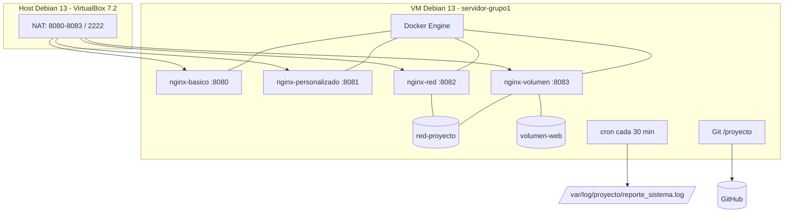

# Informe, evidencias y repositorio

> El informe no se escribe al final «de memoria»: se arma **mientras** se ejecuta cada
> fase. Cada comando importante produce una captura y un párrafo de explicación.

---

## 1. Estructura recomendada del PDF

| Sección | Páginas aproximadas | Contenido |
|---|---|---|
| Portada | 1 | Datos institucionales, título, grupo, integrantes, docente y fecha |
| Índice | 1 | Generado automáticamente |
| Introducción y objetivos | 1–2 | Qué se construyó, por qué y qué se espera demostrar |
| Marco teórico breve | 2–3 | Linux, virtualización, Docker, Git, cron (solo lo que uses) |
| Arquitectura de la solución | 2 | Diagrama, puertos, componentes y decisiones |
| Fase 1 | 1–2 | Hostname, usuarios, grupos, permisos y evidencias |
| Fase 2 | 1–2 | Script, cron y log |
| Fase 3 | 1–2 | Git local, GitHub y trabajo en equipo |
| Fase 4 | 1–2 | Instalación de Docker y `hello-world` |
| Fase 5 | 1–2 | Nginx, puerto 8080 y bind mount |
| Fase 6 | 1–2 | Dockerfile, imagen propia y puerto 8081 |
| Fase 7 | 2 | Red `red-proyecto` y volumen `volumen-web` |
| Fase 8 | 1–2 | Pruebas, verificación integral y reinicio |
| Resultados | 1 | Tabla de puertos, estado de servicios y capturas finales |
| Dificultades y soluciones | 1 | Errores reales y cómo se resolvieron (suma puntos) |
| Conclusiones | 1 | Aprendizajes y relación con el software libre |
| Recomendaciones / trabajo futuro | 0.5 | HTTPS, Compose, CI/CD, monitoreo, backups |
| Bibliografía | 0.5 | Documentación oficial de Debian, Docker, Nginx, Git |
| Anexos | 3–5 | Scripts, Dockerfile, cron, README y capturas adicionales |

**Extensión total sugerida:** 20–30 páginas.

> La portada y el índice son obligatorios. Un informe sin índice o sin capturas por fase pierde puntos aunque el servidor funcione.

---

## 2. Plantilla para redactar cada fase

Usa `plantillas/informe_plantilla.md` como esqueleto (ya trae portada, fases y anexos) y rellénalo con tus palabras:

````markdown
## Fase X — Título de la fase

### Objetivo
Qué pide el enunciado y qué se va a conseguir.

### Conceptos clave
Definiciones breves: usuario, grupo, setgid, bind mount, volumen, red bridge, etc.

### Procedimiento
Pasos ordenados. Incluye los comandos en bloques de código y explica qué hace cada uno.

```bash
comando de ejemplo
```

### Verificación
Comando ejecutado y salida obtenida. Explica por qué esa salida demuestra que funciona.

### Evidencia
Figura N. Captura de pantalla de ...

### Conclusión de la fase
Qué quedó funcionando y qué se aprendió.
````

Reglas de redacción:

- Explica **por qué** se ejecuta un comando, no solo lo pegues.
- Usa el mismo nombre para todo (`servidor-grupo1`, `nginx-basico`, etc.).
- Incluye al menos un error real y su solución; demuestra aprendizaje.
- No incluyas contraseñas, tokens ni claves.
- Numera figuras y tablas y referéncialas en el texto («Figura 7»).

---

## 3. Evidencias: cómo tomarlas y organizarlas

### 3.1 Convención de nombres

```text
/proyecto/capturas/
  F01_01_hostname.png
  F01_02_usuarios_id.png
  F01_03_grupos.png
  ...
  F08_04_git_status.png
```

`F0X` = fase, `NN` = orden, descripción corta en minúsculas y sin espacios.

### 3.2 Qué debe mostrar cada captura

- El **comando completo** y su **salida**, no solo el resultado.
- El prompt con el usuario y el host: `adminsys@servidor-grupo1:~$`.
- La fecha visible si es posible.
- En el navegador: la **URL completa** (`http://localhost:8080`).
- Nada de datos personales, tokens ni contraseñas.

### 3.3 Cómo capturar

| Método | Cuándo usarlo |
|---|---|
| Captura de pantalla del host (`Impr Pant`, Spectacle, Flameshot) | Terminal SSH y navegador del host |
| `gnome-screenshot` / `scrot` dentro de la VM | Si instalas escritorio en la VM |
| `script -a /proyecto/capturas/fase5_sesion.log` | Respaldo de la sesión de terminal (texto) |
| Grabadora de pantalla | Video de respaldo para la defensa |

Amplía la terminal (fuente 14–16), limpia la pantalla antes de cada bloque y evita imágenes borrosas o recortadas.

### 3.4 Índice de capturas

Crea `/proyecto/capturas/INDICE.md` con una tabla como la del apéndice C de la guía. Así sabes qué falta antes de redactar.

### 3.5 Capturas mínimas por fase

| Fase | Capturas mínimas |
|---|---|
| 1 | hostname + usuarios + grupos + permisos + herencia |
| 2 | script + cron + log con timestamps |
| 3 | git log + remoto + GitHub + commits de los 4 |
| 4 | docker info + grupo docker + hello-world + ps -a |
| 5 | docker ps + navegador 8080 + logs |
| 6 | Dockerfile + build + navegador 8081 + comparación |
| 7 | network inspect + navegador 8082 + volume inspect + navegador 8083 |
| 8 | ping + 4 puertos + log + git status (+ reinicio) |

---

## 4. Diagrama de arquitectura

Incluye un diagrama como este (puedes exportarlo desde Mermaid Live o draw.io):



Explica en el texto:

- La VM es el servidor; el host solo administra y muestra.
- Los puertos del host se reenvían a la VM.
- Cada contenedor demuestra una técnica distinta.
- `red-proyecto` conecta 8082, 8083 y Alpine.
- `volumen-web` persiste aunque se borre el contenedor.
- Cron y Git viven en el sistema operativo, no dentro de los contenedores.

---

## 5. README del repositorio

El README debe permitir que otra persona entienda y reproduzca el proyecto. Secciones mínimas:

1. **Título y descripción.**
2. **Integrantes** (con usuario de GitHub).
3. **Tecnologías.**
4. **Arquitectura y puertos** (tabla).
5. **Estructura del repositorio.**
6. **Requisitos** (Debian 13, Docker, Git).
7. **Instalación paso a paso** (resumen de las fases, no una copia completa).
8. **Uso y verificación** (comandos `curl`, `docker ps`).
9. **Scripts y automatización** (cron).
10. **Evidencias** (enlace a `capturas/`).
11. **Licencia** (opcional).

Usa `plantillas/README-proyecto.md` como base.

---

## 6. Convertir Markdown a PDF

### Opción A: Pandoc + LaTeX (recomendada)

```bash
sudo apt install -y pandoc texlive-xetex texlive-lang-spanish fonts-dejavu
cd /ruta/al/informe
pandoc informe.md \
  -o informe.pdf \
  --pdf-engine=xelatex \
  -V geometry:margin=2.5cm \
  -V mainfont="DejaVu Sans" \
  -V lang=es \
  --toc --toc-depth=2 \
  --highlight-style=tango
```

- Coloca las imágenes en una carpeta `img/` y usa rutas relativas.
- Para saltos de página: `\newpage` en una línea (con LaTeX) o `---` si usas otra herramienta.
- Revisa el PDF en otro dispositivo antes de entregar.

### Opción B: VS Code

Extensión **Markdown PDF** → clic derecho → *Export (pdf)*. Configura tamaño de página y márgenes.

### Opción C: Google Docs / Word

Sube el Markdown o copia el contenido, aplica estilos y exporta a PDF. Es más lento, pero útil si el equipo ya trabaja en Docs.

---

## 7. Autoevaluación con la rúbrica del enunciado

| Requisito del PDF | ¿Dónde está en el informe? | ¿Evidencia? |
|---|---|---|
| Hostname y usuarios | Fase 1 | F01_01–F01_03 |
| Grupos y sudo | Fase 1 | F01_02–F01_03 |
| Directorios y permisos | Fase 1 | F01_04–F01_05 |
| Script de monitoreo | Fase 2 | F02_01 |
| Cron cada 30 min | Fase 2 | F02_02–F02_03 |
| Git local y remoto | Fase 3 | F03_01–F03_03 |
| README | Fase 3 / repositorio | F03_03 |
| Instalación de Docker | Fase 4 | F04_01 |
| `hello-world` | Fase 4 | F04_03 |
| Nginx 8080 | Fase 5 | F05_01–F05_03 |
| Dockerfile e imagen | Fase 6 | F06_01–F06_03 |
| Red y volumen | Fase 7 | F07_01–F07_04 |
| Pruebas y verificación | Fase 8 | F08_01–F08_05 |
| Explicación de cada fase | Todas | Texto + capturas |

---

## 8. Errores que cuestan puntos

- Pegar comandos sin explicar qué hacen.
- Capturas sin el comando o sin la salida.
- Olvidar una fase o un puerto.
- No demostrar la herencia de grupo con un archivo real.
- Subir contraseñas o tokens al repositorio.
- Un solo integrante con commits.
- Contenedores que no vuelven tras reiniciar.
- PDF sin portada, sin índice o sin numeración.
- Presentación leída palabra por palabra.
- No probar la OVA en otra computadora.

---

## 9. Nombres de archivo sugeridos para la entrega

```text
ISL135_ProyectoFinal_Grupo1.pdf
proyecto-linux-grupo1/          (repositorio)
ISL135_ProyectoFinal_Grupo1_Presentacion.pdf
proyecto-isl135-grupo1.ova
proyecto-isl135-grupo1.ova.sha256
```
